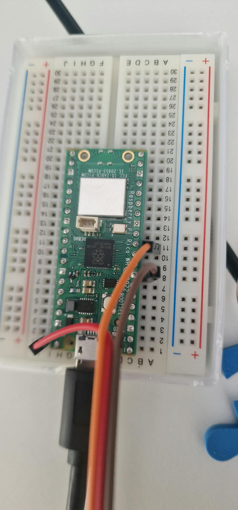

# Parksystem mit Schranke – M450

Intelligentes Parksystem mit (simulierter) Kennzeichenerkennung auf zwei Raspberry Pi Pico W, programmiert mit Arduino.

## Gruppenmitglieder

- Atieh Rostamian
- Sabina Lazri

Lehrperson: Adrian Elsener

## Kurze Beschreibung der Umsetzung

Das System besteht aus zwei Raspberry Pi Pico W, die über WLAN miteinander sprechen (Aufbau wie im Testkonzept beschrieben).

| | Pico 1 – Kasse | Pico 2 – Schranken |
|---|---|---|
| Sketch | [`pico1_kasse/`](pico1_kasse/pico1_kasse.ino) | [`pico2_schranken/`](pico2_schranken/pico2_schranken.ino) |
| Weboberfläche | Kassenautomat: Kennzeichen eingeben, Betrag anzeigen, bezahlen (Karte / TWINT / Bargeld simuliert), Quittung optional | Kamera-Simulation für Einfahrt und Ausfahrt, Anzeige freie Plätze, Admin-Panel |
| Hardware | Servo Ausfahrt an GP8 | Servo Einfahrt an GP8 |
| Daten | Parkvorgänge mit Einfahrtszeit und Zahlungen | Offene Parkvorgänge, Archiv, Logbuch |

Pico 2 spannt das Test-WLAN als Access Point auf. Pico 1 verbindet sich damit und meldet sich alle 5 Sekunden bei Pico 2. So kennt Pico 2 die Adresse der Kasse, und die Uhren der beiden Picos werden abgeglichen.

**Ablauf**

1. **Einfahrt:** In der Kamera-Simulation wird das Kennzeichen eingetippt. Pico 2 prüft es, speichert Kennzeichen und Einfahrtszeit, öffnet die Einfahrtsschranke (Servo) und meldet die Einfahrt an Pico 1.
2. **Kasse:** Am Kassenautomaten (Pico 1) gibt der Gast sein Kennzeichen ein. Der Betrag wird berechnet (CHF 1.50 pro angebrochene 15 Minuten). Nach der Zahlung gilt das Kennzeichen 15 Minuten als «bezahlt» (Karenzzeit). Danach kann eine Quittung angezeigt werden.
3. **Ausfahrt:** In der Kamera-Simulation wird das Kennzeichen an der Ausfahrt eingetippt. Pico 2 fragt bei Pico 1 den Bezahlstatus ab. Nur bei «bezahlt» innerhalb der Karenzzeit öffnet die Ausfahrtsschranke (Pico 2 schickt Pico 1 den Befehl, dessen Servo zu öffnen), und der Parkvorgang wird archiviert. Sonst bleibt sie zu und das Display zeigt «Parkgebühr nicht bezahlt. Bitte zum Automaten.»
4. Die Schranken schliessen nach 5 Sekunden automatisch. Während eine Schranke offen ist, leuchtet die LED auf Pico 2.

**Uhrzeit:** Der Pico hat keine Echtzeituhr und im Test-WLAN gibt es kein Internet (kein NTP). Beim ersten Aufruf einer Weboberfläche übernimmt der Pico deshalb die Uhrzeit des Browsers. Pico 2 ist die Referenzuhr, Pico 1 übernimmt die Zeit von Pico 2. Nach einem Neustart von Pico 2 holt sich Pico 2 die Zeit von Pico 1 zurück.

**Speicherung:** Offene Parkvorgänge, Zahlungen, Archiv und Logbuch werden im Flash (LittleFS) gespeichert und überstehen einen Neustart.

### Festgelegte Werte (aus Testkonzept, Kapitel 2.5)

| Wert | Festlegung |
|---|---|
| Tarif | CHF 1.50 pro angebrochene 15 Minuten |
| Karenzzeit | 15:00 Minuten ab Bezahlung, bis und mit 15:00 |
| Kapazität | 5 Parkplätze |
| Admin-Konto | `betreiber1` / `Park2026!` (nur im Test-WLAN) |
| Meldung unlesbares Kennzeichen | «Kennzeichen nicht erkannt. Bitte Hilfeknopf drücken.» |
| Meldung nicht bezahlt | «Parkgebühr nicht bezahlt. Bitte zum Automaten.» |
| Anzeige voll | «Besetzt» |

Die Werte stehen als Konstanten oben in den beiden Sketches bzw. in [`tarif.h`](pico1_kasse/tarif.h).

## Umgesetzte User Stories / Anforderungen

| User Story | Umsetzung | Status | Testfälle |
|---|---|---|---|
| **US 1** Automatische Einfahrt | Kennzeichen über Kamera-Simulation erfassen, prüfen, mit Datum und Uhrzeit speichern, danach Schranke öffnen. Unlesbares Kennzeichen (leer, «???») → «Kennzeichen nicht erkannt. Bitte Hilfeknopf drücken.», Schranke bleibt zu. Kennzeichen mit Umlauten/Bindestrich (UTF-8) werden korrekt gespeichert. | ✅ umgesetzt | TC-01, TC-02, TC-11 |
| **US 2** Bezahlung am Parkautomaten | Kennzeichen eingeben, Betrag nach Parkdauer berechnen, Zahlung mit Karte / TWINT / Bargeld (simuliert), danach 15 Minuten «bezahlt». Quittung optional («Quittung drucken? Ja/Nein»). Nach Ablauf der Karenzzeit wird eine Nachzahlung verlangt. | ✅ umgesetzt (Zahlung simuliert) | TC-03, TC-10, TC-14 |
| **US 3** Kontrollierte Ausfahrt | Bezahlstatus bei Pico 1 abfragen. Bezahlt und innerhalb Karenzzeit → Schranke öffnet, schliesst automatisch, Parkvorgang wird archiviert. Sonst bleibt die Schranke zu. Ist Pico 1 nicht erreichbar, bleibt die Schranke ebenfalls zu. | ✅ umgesetzt | TC-04, TC-05, TC-06, TC-12, TC-13 |
| **US 4** Statusanzeige & Besetzt-Meldung | Freie Plätze werden bei jeder Ein- und Ausfahrt gezählt und auf der Kamera-Simulation sowie unter `/anzeige` angezeigt. Bei 0 freien Plätzen «Besetzt», Einfahrt bleibt zu. | ✅ umgesetzt | TC-08, TC-16 |
| **US 5** Manuelle Notfall-Öffnung | Admin-Panel mit Login, jede Schranke einzeln manuell öffnen (auch bei «Besetzt»), jede Öffnung im Logbuch mit Uhrzeit und Benutzerkonto. Hilfeknopf an Ein- und Ausfahrt. Reset-Funktion für die Tests. | ✅ umgesetzt (über Weboberfläche, kein physischer Schalter) | TC-07, TC-09, TC-15 |
| Nicht-funktional: Wiederherstellbarkeit | Offene Parkvorgänge und Zahlungen bleiben nach Stromunterbruch erhalten (LittleFS). | ✅ umgesetzt | TC-17 |
| Minimaler Funktionsumfang (Aufgabe) | Ein- und Ausfahrtsschranke, Berechnung und Bezahlung der Parkgebühr | ✅ umgesetzt | – |

**Nicht umgesetzt (bewusst, siehe Testkonzept 2.3):** echte Kamera / Bilderkennung, echtes Zahlungsterminal und TWINT, physischer Schalter für die Notfall-Öffnung.

## Hardware und Verdrahtung

- 2 × Raspberry Pi Pico W
- 2 × Servo SG90: Einfahrt an **Pico 2**, Ausfahrt an **Pico 1**

Beide Picos sind gleich verdrahtet:

| SG90 | Pico |
|---|---|
| rot (VCC) | VBUS, Pin 40 (5 V) |
| braun (GND) | GND, Pin 8 |
| orange (Signal) | GP8, Pin 11 |

Die Ausfahrtsschranke an Pico 1 öffnet nur auf Befehl von Pico 2 (`/api/schranke`). Alternativ kann der Ausfahrts-Servo auch an Pico 2 (GP9, Pin 12) hängen, Pico 2 steuert beide Varianten an. Ist Pico 1 nicht erreichbar, kann die Ausfahrt dann nur noch über GP9 von Pico 2 geöffnet werden.

Schranke zu = 90°, offen = 0° (`WINKEL_ZU`, `WINKEL_OFFEN` oben in beiden Sketches). Steht der Arm bei «zu» nicht waagrecht, den Arm vom Servo abziehen und waagrecht wieder aufstecken. Dreht er beim Öffnen in die falsche Richtung, `WINKEL_OFFEN` auf 180 setzen.



## Installation

1. Arduino IDE installieren.
2. Unter *Datei → Einstellungen → Zusätzliche Boardverwalter-URLs* eintragen:
   `https://github.com/earlephilhower/arduino-pico/releases/download/global/package_rp2040_index.json`
3. Im Boardverwalter **«Raspberry Pi Pico/RP2040/RP2350» (Earle F. Philhower)** installieren. Alle verwendeten Bibliotheken (`WiFi`, `WebServer`, `HTTPClient`, `Servo`, `LittleFS`) sind darin enthalten.
4. Board **«Raspberry Pi Pico W»** wählen.
5. Unter *Werkzeuge → Flash Size* eine Variante **mit FS** wählen (z.B. «2MB (Sketch: 1MB, FS: 1MB)»). Sonst funktioniert die Speicherung nicht.
6. `pico2_schranken/pico2_schranken.ino` auf den Pico mit den Servos laden, `pico1_kasse/pico1_kasse.ino` auf den anderen Pico.

**Alternative: VS Code mit PlatformIO.** `parksystem.code-workspace` öffnen (*Datei → Arbeitsbereich aus Datei öffnen*). Jeder Sketch-Ordner hat eine eigene `platformio.ini`. Mit «Upload» in der PlatformIO-Leiste wird der Sketch des gewählten Ordners auf den Pico geladen.

## Bedienung

1. Pico 2 zuerst einschalten. Er erstellt das WLAN **`Parksystem-TEST`** (Passwort `parken2026`).
2. Pico 1 einschalten. Er verbindet sich automatisch.
3. Laptop oder Handy mit dem WLAN `Parksystem-TEST` verbinden.

| Seite | Adresse |
|---|---|
| Kamera-Simulation (Einfahrt/Ausfahrt) | http://192.168.42.1/ |
| Anzeige freie Plätze | http://192.168.42.1/anzeige |
| Admin-Panel | http://192.168.42.1/admin |
| Kasse (Pico 1) | Link «Kasse (Pico 1)» in der Navigation von Pico 2, die IP steht auch im seriellen Monitor von Pico 1 |

Der serielle Monitor (115200 Baud) zeigt bei beiden Picos, was passiert (Einfahrt, Zahlung, Schranke offen/zu, Logbuch).

## Schnittstelle Pico 1 ↔ Pico 2

Alle Anfragen sind einfache HTTP-GET-Anfragen mit dem gemeinsamen Schlüssel `key`. Pico 2 schickt bei jeder Anfrage seine Uhrzeit (`t`, `tz`) mit.

| Richtung | Anfrage | Antwort |
|---|---|---|
| Pico 1 → Pico 2 | `/api/hello?t=..&tz=..&ok=..` | `ok=1`, `t=..`, `tz=..` (Uhrzeit von Pico 2) |
| Pico 2 → Pico 1 | `/api/einfahrt?kz=..&einfahrt=..` | `ok` |
| Pico 2 → Pico 1 | `/api/status?kz=..` | `status=bezahlt` / `offen` / `abgelaufen` / `unbekannt`, `bezahlt=..`, `rappen=..` |
| Pico 2 → Pico 1 | `/api/ausfahrt?kz=..` | `ok` |
| Pico 2 → Pico 1 | `/api/reset` | `ok` |
| Pico 2 → Pico 1 | `/api/schranke` (Ausfahrtsschranke öffnen) | `ok` |

Kann eine Einfahrt nicht sofort an Pico 1 gemeldet werden (z.B. WLAN-Unterbruch), liefert Pico 2 sie automatisch nach. Im Admin-Panel steht pro Parkvorgang, ob er schon übermittelt wurde.

## Projektstruktur

```
parksystem/
├── README.md
├── pico1_kasse/
│   ├── pico1_kasse.ino      Kasse, Ausfahrtsschranke, Schnittstelle für Pico 2
│   ├── tarif.h              Tarif- und Karenzzeitberechnung
│   └── kennzeichen.h        Kennzeichen normalisieren (identisch mit Pico 2)
├── pico2_schranken/
│   ├── pico2_schranken.ino  Einfahrtsschranke, Kamera-Simulation, Anzeige, Admin-Panel
│   └── kennzeichen.h        Kennzeichen normalisieren und prüfen
└── docs/
    ├── Testkonzept_Parksystem_v1.1.pdf
    └── aufbau.jpeg
```

## Tests

Die manuellen Testfälle TC-01 bis TC-17 stehen im [Testkonzept](docs/Testkonzept_Parksystem_v1.1.pdf). Vor jedem Testfall aus Block A wird im Admin-Panel «System zurücksetzen» ausgeführt.
